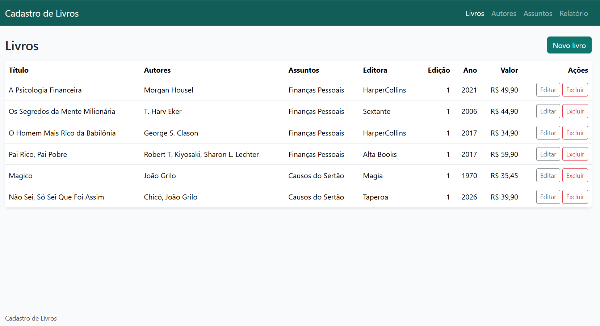
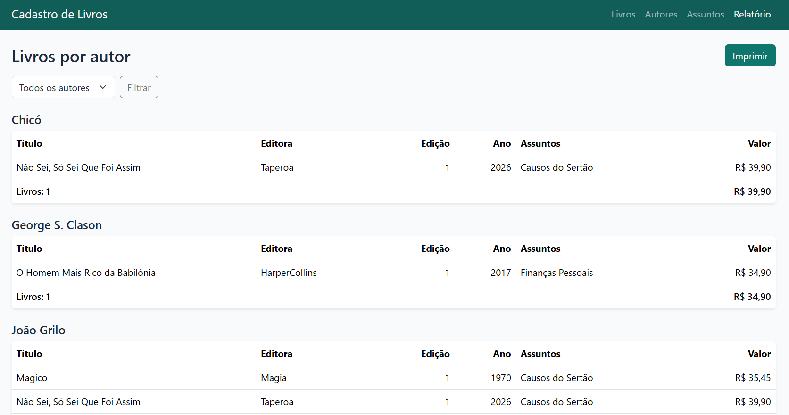

# Cadastro de livros

Projeto desenvolvido para um desafio técnico, sem framework.

Cadastro de livros, autores e assuntos, e relatório de livros agrupados por autor.

Stack: PHP 8.5, MySQL 8.4, Bootstrap 5.3, PHPUnit 13 e Docker Compose.

## Como rodar

Precisa de Docker com o Compose.

    docker compose up --build -d

Depois abra http://localhost:8091.

Na primeira subida o MySQL roda os scripts de `database/`: cria o banco de teste, as tabelas, a view do relatório e um livro de exemplo. Esses scripts só rodam quando o volume é criado. Para recriar o banco do zero (apaga os dados):

    docker compose down -v
    docker compose up -d

## Telas

| Caminho | O que faz |
|---|---|
| `/livros` | Lista, cadastro, alteração e exclusão de livros |
| `/autores` | Cadastro de autores |
| `/assuntos` | Cadastro de assuntos |
| `/relatorio` | Livros por autor, com filtro e botão de imprimir |

## Relatório

Vem da view `vw_livros_por_autor` (`database/04-relatorio.sql`), que junta `Livro`, `Autor` e `Assunto`. Uma linha por livro e autor, com os assuntos do livro juntos numa coluna.

- O livro com mais de um autor aparece no grupo de cada autor, mas entra uma vez só no total geral.
- Os valores são somados em centavos, sem `float`.
- Autor sem livro não aparece.
- Para PDF, use o botão Imprimir e salve como PDF no navegador. O menu e o filtro não saem na impressão.

## Estrutura

    database/   scripts do MySQL, rodam em ordem
    public/     index.php e assets
    src/        Nucleo/ e uma pasta por recurso (Livro, Autor, Assunto, Relatorio)
    views/      templates PHP
    tests/      testes, uma pasta por recurso

Cada recurso tem `Repositorio` (SQL), `Servico` (regras e validação) e `Controller` (HTTP). As rotas ficam em `src/rotas.php`.

## Núcleo

É a base própria da aplicação, em PHP puro: resolve banco, HTTP e erros uma vez só, e cada recurso cuida apenas da sua regra de negócio. Classes em `src/Nucleo/`:

- `Banco`: PDO, consultas com parâmetros e transações
- `Repositorio`: CRUD genérico, cada tabela herda dele
- `Http`: rotas, token dos formulários e página de erro em um só lugar
- `Requisicao` / `Resposta`: entrada do formulário, saída em HTML ou JSON
- `Sessao`: token CSRF e aviso de uma vez só
- `View`: páginas PHP dentro do layout, com escape de HTML
- `ErroAplicacao`: erro com status HTTP (404, 409, 422...)

## Testes

Rodam no banco `livros_teste`, que os testes apagam e recriam, sem mexer no banco da aplicação.

    docker compose exec app composer test
